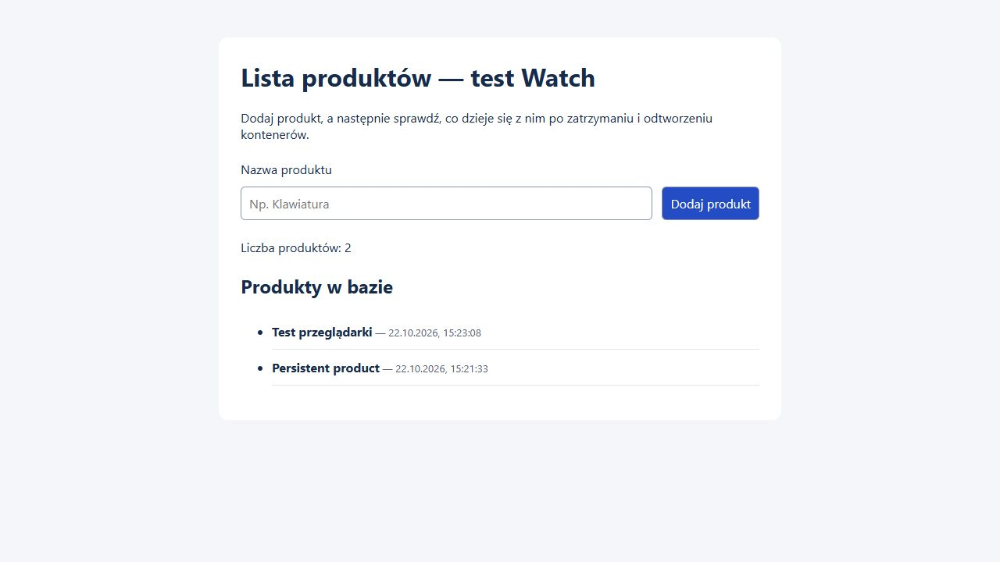

# Lab 4 – uwagi dla prowadzącego

Instrukcja studencka: [lab4.md](../lab4.md). Plan zakłada około 90 minut pracy po pobraniu obrazów. Wersja startowa w `sample-app/docker-compose.yml` celowo nie ma wolumenu, healthchecka, osobnych sieci ani Watch. Polityka `restart: unless-stopped` jest obecna od początku, aby backend mógł wznowić pracę po zbyt wczesnej próbie połączenia z SQL Server.

## Przygotowanie przed zajęciami

- Na maszynach studentów sprawdź Linux x86-64, co najmniej 2 GB RAM dla samego SQL Server oraz zapas na .NET i budowanie; praktycznie zaplanuj co najmniej 4 GB RAM na maszynę dla tego zestawu.
- Sprawdź Docker Compose >= 2.22.0 i dostęp studentów do Dockera.
- Pobierz obrazy i zbuduj aplikację na każdej maszynie; pierwszy transfer SQL Server i SDK może zająć znaczną część zajęć.
- Brama WWW musi przekazywać `/site/N/` na port 8080 maszyny N, usuwając prefiks `/site/N/`. Frontend używa względnego `api/products`.
- Sprawdź GET i POST produktów przez faktyczną bramę. W ćwiczeniu z portem 8081 student testuje API lokalnym `curl`, po czym wraca do 8080.

Z katalogu `lab4/sample-app`:

```bash
docker compose config --quiet
docker compose pull db
docker compose build
docker pull python:3.12-alpine
```

Przygotowanie nie wymaga pozostawienia uruchomionych kontenerów. Nie usuwaj ani nie zatrzymuj cudzych projektów lub danych podczas przygotowania maszyn.

## Rozwiązanie wzorcowe

Plik [compose.final.yml](compose.final.yml) jest kompletną, samodzielną konfiguracją. Jest materiałem do porównania po ćwiczeniach. Ścieżki `build` i `watch.path` odnoszą się do oryginalnego `lab4/sample-app`, a nie kopii w katalogu oddania studenta.

Z katalogu `lab4/sample-app`, po zatrzymaniu uruchomionej tam wersji startowej:

```bash
docker compose down
docker compose -f ../instructor/compose.final.yml config --quiet
docker compose -f ../instructor/compose.final.yml up -d --build
docker compose -f ../instructor/compose.final.yml ps
curl -fsS http://localhost:8080/api/products
docker compose -f ../instructor/compose.final.yml watch
```

W drugim terminalu edytuj `lab4/sample-app/frontend/index.html`. `Ctrl+C` kończy sam Watch. Po demonstracji:

```bash
docker compose -f ../instructor/compose.final.yml down
```

Obie konfiguracje używają projektu `lab4` oraz tych samych tagów obrazów. Nie uruchamiaj ich jednocześnie. Rozwiązanie używa wolumenu `lab4_db-data`; zwykłe `down` zachowuje dane. Usuwanie wolumenu wymaga świadomego `down -v` i powinno dotyczyć wyłącznie demonstracyjnych danych po ocenie.

## Oczekiwane obserwacje

| Próba | Oczekiwany wynik |
|---|---|
| `stop/start` bez nazwanego wolumenu | Dane pozostają, bo kontener nie został usunięty. |
| `down/up` bez trwałego montowania | Nowa baza bez wcześniejszych produktów. |
| `down/up` z `db-data` | Produkty pozostają. |
| `down -v/up` z `db-data` | Dane usunięte; w części obowiązkowej student wyłącznie przewiduje wynik. |
| SQL `SELECT 1` w healthchecku | `healthy`; backend startuje po pozytywnym sprawdzeniu bazy. |
| TCP do `db:1433` z `backend-network` | Powodzenie. |
| TCP do `db:1433` z `app-network` | Błąd DNS lub połączenia i niezerowy kod zakończenia. |
| Watch po zmianie HTML | Nowy nagłówek po odświeżeniu, produkty bez zmian. |

Brak błędu startowego backendu w konkretnej próbie jest dopuszczalny: wyścig zależy od czasu startu SQL Server. Oceniaj poprawność konfiguracji i rozumienie różnicy między uruchomieniem procesu a gotowością bazy.

## Kryteria zaliczenia

Wymagaj własnego katalogu `lab4/submissions/<login>/`, działającego pliku Compose, sprawozdania i dowodów wskazanych w instrukcji. Sprawdź, czy student nie skopiował tylko konfiguracji, lecz udokumentował eksperyment trwałości i oba wyniki sieciowe. Kopia studenta zawiera `sample-app` oraz `README.md`; w PR nie powinien zmieniać wzorca ani cudzych katalogów.

Przy ograniczonym czasie uruchamianie ręczne może być demonstracją prowadzącego. Priorytetem samodzielnej pracy są Compose, trwałość danych, gotowość i sieci; Watch wykonaj po tych częściach. Przenoszenie Dockerfile jest rozszerzeniem.

## Źródła scenariusza

- Wcześniejsze materiały WSEI: aplikacja frontend + API .NET + SQL Server + gateway; porównanie uruchamiania ręcznego z Compose, healthcheck i podział sieci.
- Materiały wzorcowe AGH `dev_ops_lato_2025`, Lab 5: Compose Watch, zmiana portów, oddzielenie kodu i Dockerfile.
- Materiały wzorcowe AGH `dev_ops_lato_2025`, Lab 6: eksperyment trwałości oraz testy połączeń między kontenerami. Zamiast zapamiętywania IP używamy nazw usług.
- [Dokumentacja Compose Watch](https://docs.docker.com/compose/how-tos/file-watch/), [kolejność i gotowość usług](https://docs.docker.com/compose/how-tos/startup-order/), [sieci](https://docs.docker.com/compose/how-tos/networking/), [zachowanie `down`](https://docs.docker.com/reference/cli/docker/compose/down/).

## Weryfikacja materiałów — 22 października 2026

Test lokalny wykonano w Docker Desktop z kontenerami Linux, Docker Engine 29.9.2 i Compose 5.6.0, w osobnym projekcie testowym. Zbudowano wszystkie trzy obrazy aplikacji i zweryfikowano obie konfiguracje Compose.

Potwierdzono zapis i odczyt produktów, odrzucenie pustej nazwy, zachowanie danych po `stop/start`, utratę danych po `down/up` bez wolumenu i zachowanie po `down/up` z wolumenem. Sprawdzono dodatni healthcheck SQL, oba testy sieci, zmianę portu gateway oraz synchronizację HTML przez Watch bez utraty produktów. Sprawdzono również składnię 28 bloków poleceń Bash, JavaScript frontendu i lokalne odnośniki w materiałach.

Dodatkowy lokalny Nginx symulował usuwanie prefiksu `/site/23/` przez bramę. Pod tym adresem sprawdzono w przeglądarce wyświetlenie produktów i dodanie nowego produktu formularzem. Rzeczywista brama uczelniana i maszyny studentów wymagają sprawdzenia przed zajęciami; ten test ich nie modyfikował. Minimalna wersja Compose wynika z dokumentacji Watch; test wykonano na wersji podanej powyżej.


