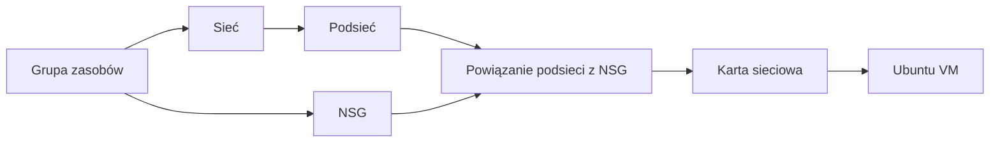

# Laboratorium 6 – Azure VM, zależności, Terraform i Bicep

W tym labie utworzycie w Azure maszynę Ubuntu z prywatnym adresem, sieć z podsiecią i grupę zabezpieczeń (NSG). Porównacie kolejność operacji w skrypcie Azure CLI z zależnościami zapisanymi w Terraformie lub Bicepie.

## 1. Otwórz Azure Cloud Shell i sprawdź subskrypcję

Zaloguj się do [Azure Portal](https://portal.azure.com/), otwórz **Cloud Shell** ikoną `>_` i wybierz **PowerShell**. Jeśli widzisz Bash, użyj opcji **Switch to PowerShell** na pasku Cloud Shell. Azure CLI, Terraform i Bicep są już dostępne, a Cloud Shell korzysta z logowania do portalu. [Narzędzia i logowanie Cloud Shell](https://learn.microsoft.com/azure/cloud-shell/features)

Jeśli Cloud Shell zapyta o magazyn, użyj istniejącego magazynu wskazanego przez prowadzącego lub wybierz sesję bez konta Storage. W sesji bez magazynu pliki znikają po jej zakończeniu. W tym trybie po każdym `terraform apply` pobierz przez **Manage files → Download** pliki `terraform.tfstate`, `main.tf` i `~/.ssh/lab6_rsa.pub`. Trzymaj je poza repozytorium. Po przerwaniu sesji sklonuj ponownie repozytorium, odtwórz pliki w ich katalogach, ustaw te same zmienne i wykonaj `terraform init` przed sprzątaniem. [Sesja bez magazynu](https://learn.microsoft.com/azure/cloud-shell/get-started/ephemeral) · [Pobieranie plików z Cloud Shell](https://learn.microsoft.com/azure/cloud-shell/use-the-shell-window#manage-files-menu)

Sprawdź, czy aktywna subskrypcja w Cloud Shell jest tą wskazaną przez prowadzącego. Potrzebujesz uprawnień do tworzenia grup zasobów i zarządzania zasobami Compute i Network. Ścieżka Bicep wymaga także uprawnień do wdrożeń w grupie zasobów.

```powershell
$env:ARM_SUBSCRIPTION_ID = az account show --query id --output tsv
az account show --query '{name:name,id:id}' --output table
terraform version
```

Sprawdź rejestrację providerów w wybranej subskrypcji. Skrypt zaczeka na rejestrację tych, które nie mają statusu `Registered`. Jeśli Azure odmówi dostępu, poproś prowadzącego o rejestrację. [Polecenia az provider](https://learn.microsoft.com/cli/azure/provider#az-provider-register)

```powershell
foreach ($provider in 'Microsoft.Compute', 'Microsoft.Network') {
    $state = az provider show -n $provider --subscription $env:ARM_SUBSCRIPTION_ID `
        --query registrationState -o tsv
    if ($LASTEXITCODE -ne 0) { throw "Nie udało się sprawdzić providera $provider." }
    Write-Host "${provider}: $state"
    if ($state -ne 'Registered') {
        az provider register -n $provider --subscription $env:ARM_SUBSCRIPTION_ID --wait
        if ($LASTEXITCODE -ne 0) { throw "Nie udało się zarejestrować providera $provider." }
    }
}
```

Utwórz klucz SSH dla labu.

```powershell
$sshDir = Join-Path $HOME '.ssh'
New-Item -ItemType Directory -Path $sshDir -Force | Out-Null
$sshKey = Join-Path $sshDir 'lab6_rsa'
if (-not (Test-Path -LiteralPath "$sshKey.pub" -PathType Leaf)) {
    ssh-keygen -t rsa -b 3072 -f $sshKey
}
```

Sklonuj repozytorium studiów stacjonarnych i przejdź do katalogu `lab6/`. Jeśli masz już aktualny klon, otwórz w nim katalog `lab6/`.

```powershell
Set-Location $HOME
git clone https://github.com/robert-cialowicz-ideispl/wsei-devops-lab-z26s.git
Set-Location 'wsei-devops-lab-z26s/lab6'
```

Przekaż Azure tylko klucz publiczny (`.pub`). Karta VM ma wyłącznie prywatny adres. W podsieci jawnie włączamy domyślne wyjście do Internetu. NSG przy podsieci nie otwiera portów dla Internetu.

### Znajdź dostępny rozmiar VM i region

```powershell
$freeSizes = @('Standard_B1s', 'Standard_B2ats_v2')
$sub = $env:ARM_SUBSCRIPTION_ID
$assignmentsJson = az policy assignment list --subscription $sub --filter 'atScope()' -o json
if ($LASTEXITCODE -ne 0) { throw 'Nie można odczytać polityk subskrypcji.' }
$locationPolicies = $assignmentsJson | ConvertFrom-Json | Where-Object {
    $_.displayName -in 'Allowed locations', 'Allowed locations for resource groups' -and
    $_.enforcementMode -ne 'DoNotEnforce' -and $_.parameters.listOfAllowedLocations
}

$regions = if ($locationPolicies) {
    @($locationPolicies)[0].parameters.listOfAllowedLocations.value
} else {
    az account list-locations --subscription $sub --query "[?metadata.regionType=='Physical'].name" -o tsv
    if ($LASTEXITCODE -ne 0) { throw 'Nie można odczytać listy regionów.' }
}
$regions = @($regions | Where-Object {
    $region = $_
    -not ($locationPolicies | Where-Object { $region -notin $_.parameters.listOfAllowedLocations.value })
} | Sort-Object -Property @{ Expression = { $_ -ne 'denmarkeast' } }, @{ Expression = { $_ } } -Unique)

$sizeFilter = ($freeSizes | ForEach-Object { "name=='$_'" }) -join ' || '
$query = "{nextLink:nextLink,skus:value[?resourceType=='virtualMachines' && ($sizeFilter)].{name:name,family:family,restrictions:restrictions}}"
$candidates = @()
$labChoice = $null
foreach ($region in $regions) {
    Write-Host "Sprawdzam $region..."
    $usageJson = az vm list-usage -l $region --subscription $sub -o json
    if ($LASTEXITCODE -ne 0) { throw "Nie można odczytać limitów w $region." }
    $usage = $usageJson | ConvertFrom-Json
    $regional = $usage | Where-Object { $_.name.value -eq 'cores' }
    if (-not $regional -or $regional.limit -le $regional.currentValue) { continue }

    $filter = [uri]::EscapeDataString("location eq '$region'")
    $url = 'https://management.azure.com/subscriptions/{0}/providers/Microsoft.Compute/skus?api-version=2021-07-01&$filter={1}' -f $sub, $filter
    $skus = do {
        $pageJson = az rest --method get --url $url --subscription $sub --query $query -o json
        if ($LASTEXITCODE -ne 0) { throw "Nie można odczytać rozmiarów VM w $region." }
        $page = $pageJson | ConvertFrom-Json
        $page.skus
        $url = $page.nextLink
    } while ($url)

    $candidates = @(foreach ($size in $freeSizes) {
        $sku = $skus | Where-Object { $_.name -eq $size } | Select-Object -First 1
        if (-not $sku) { continue }
        $blocked = $sku.restrictions | Where-Object {
            $_.type -eq 'Location' -and ($region -in $_.restrictionInfo.locations -or $region -in $_.values)
        }
        if ($blocked) { continue }
        $family = $usage | Where-Object { $_.name.value -eq $sku.family }
        $needed = if ($size -eq 'Standard_B1s') { 1 } else { 2 }
        if ($family -and ($regional.limit - $regional.currentValue) -ge $needed -and
            ($family.limit - $family.currentValue) -ge $needed) {
            [pscustomobject]@{ Region = $region; Size = $size; Family = $sku.family }
        }
    })
    if ($candidates.Count -gt 0) { break }
}

if ($candidates.Count -eq 0) { throw 'Brak zgodnej pary region–rozmiar. Zgłoś wynik prowadzącemu.' }
$candidates | Format-Table Region, Size, Family
$labChoice = $candidates[0]
$labChoice | Format-Table Region, Size
```

Skrypt sprawdza oba rozmiary i kończy na pierwszym regionie, w którym można wybrać co najmniej jeden z nich. Zaczyna od `denmarkeast`, jeśli polityki na to pozwalają. Każdy wariant wdrożenia używa rozmiaru wybranego w `$labChoice`. Jeśli tabela pokazuje dwa rozmiary, możesz wybrać drugi poleceniem `$labChoice = $candidates[1]`. Skan sprawdza dostępność rozmiaru dla subskrypcji i limity vCPU. Pojemność Azure jest weryfikowana przy wdrożeniu.

## 2. Demonstracja – kolejność w Azure CLI

Prowadzący uruchamia skrypt w osobnej grupie z końcówką `-cli`. Chętni mogą uruchomić go we własnej grupie, jeśli subskrypcja i czas pozwalają na utworzenie dodatkowej VM.

```powershell
./deploy-cli.ps1 -ResourceGroupName 'rg-lab6-123456-cli' -Location $labChoice.Region `
    -PublicKeyPath (Join-Path $HOME '.ssh/lab6_rsa.pub') -VmSize $labChoice.Size
```

| Etap | Czego potrzebuje |
| --- | --- |
| Utworzenie podsieci z NSG | Sieć i grupa zabezpieczeń muszą już istnieć. |
| Utworzenie karty sieciowej VM | Potrzebuje ID podsieci z przypisanym NSG. |
| Utworzenie VM | Potrzebuje ID karty sieciowej. |
| Sprawdzenie stanu i adresów VM | Maszyna musi zakończyć wdrażanie. |

Wyszukaj w skrypcie dwa użycia `--no-wait`. Te wywołania przesyłają żądanie i oddają sterowanie w trakcie operacji Azure. Następne `az network nic wait --created` i `az vm wait --created` czekają na stan `Succeeded`, maksymalnie po 900 sekund. PowerShell zatrzyma skrypt, gdy `az` zwróci błąd. Przy zwykłych wywołaniach CLI bez `--no-wait` polecenia wdrożeniowe same czekają na zakończenie swojej operacji. [Skrypt CLI](deploy-cli.ps1) · [Oczekiwanie na kartę sieciową](https://learn.microsoft.com/cli/azure/network/nic#az-network-nic-wait)

**Pytanie do grupy.** Które dwie operacje można zlecić równolegle? Tworzenie sieci i NSG może rozpocząć się równolegle po utworzeniu grupy zasobów.

## 3. Wdrożenie deklaratywne

Wykonaj ścieżkę **3a → 4a** w Terraformie lub **3b → 4b** w Bicepie, zgodnie z ustaleniami z prowadzącym. Jeśli chcesz przejść obie, po pierwszej usuń jej zasoby zgodnie z krokiem 5. Wystarczy jedna działająca VM naraz.

### 3a. Terraform

Otwórz `main.tf`. Znajdź odwołanie prowadzące z VM do karty oraz z karty do podsieci zabezpieczonej przez NSG. Ostatnie odwołanie wskazuje wynik **powiązania** podsieci z NSG, żeby Terraform wykonał to powiązanie przed utworzeniem karty. [Konfiguracja Terraform](main.tf)



Wpisz własny numer albumu i ustawienia ustalone na zajęciach. Grupa z końcówką `-tf` musi być nowa. Komunikat `true` z `az group exists` oznacza, że trzeba wybrać inną własną nazwę albo wrócić do stanu, który już zarządza tą grupą.

```powershell
$env:TF_VAR_resource_group_name = 'rg-lab6-123456-tf'
$env:TF_VAR_location = $labChoice.Region
$env:TF_VAR_vm_size = $labChoice.Size
$env:TF_VAR_ssh_public_key_path = Join-Path $HOME '.ssh/lab6_rsa.pub'
az group exists --name $env:TF_VAR_resource_group_name --subscription $env:ARM_SUBSCRIPTION_ID

terraform init
terraform validate
terraform plan
```

`terraform plan` wyświetla proponowane zmiany. Sprawdź nazwę swojej grupy i listę zasobów, a następnie uruchom wdrożenie.

```powershell
terraform apply
```

Sprawdź plan wyświetlony przez `apply` i wpisz `yes`, aby utworzyć zasoby w Azure. Obserwuj kolejność komunikatów `Creating...` oraz `Creation complete`. Terraform może tworzyć niezależne zasoby równolegle. Tam, gdzie zasób potrzebuje ID innego zasobu, graf wymusza kolejność. [Zależności zasobów w Terraformie](https://developer.hashicorp.com/terraform/language/resources/behavior)

Po zakończeniu `apply` sprawdź, czy VM ma stan `Succeeded`, rozmiar zgodny z `$labChoice`, adres prywatny z podsieci `10.60.1.0/24` i puste pole `PublicIP`.

```powershell
az vm show --resource-group $env:TF_VAR_resource_group_name --name lab6-vm --show-details `
    --query '{State:provisioningState, Size:hardwareProfile.vmSize, PrivateIP:privateIps, PublicIP:publicIps}' `
    --output json --subscription $env:ARM_SUBSCRIPTION_ID
```

### 3b. Bicep

Otwórz `main.bicep`. Znajdź odwołania do NSG w definicji podsieci, do podsieci w karcie sieciowej i do karty w VM. Azure Resource Manager wyznacza zależności z tych odwołań i uruchamia równolegle operacje, które od siebie nie zależą. [Konfiguracja Bicep](main.bicep) · [Zależności zasobów w Bicepie](https://learn.microsoft.com/azure/azure-resource-manager/bicep/resource-dependencies)

Wpisz własny numer albumu. Utwórz osobną grupę `-bicep` w regionie z `$labChoice`. Szablon bierze region z tej grupy. Zachowaj `$bicepArgs` w bieżącej sesji, bo użyjesz tej samej tablicy argumentów w zadaniu 4b.

```powershell
$bicepGroup = 'rg-lab6-123456-bicep'
$sub = $env:ARM_SUBSCRIPTION_ID
$sshPublicKey = (Get-Content -Raw (Join-Path $HOME '.ssh/lab6_rsa.pub')).Trim()
$groupExists = az group exists --name $bicepGroup --subscription $sub -o tsv
if ($LASTEXITCODE -ne 0) { throw 'Nie można sprawdzić grupy zasobów.' }
if ($groupExists -eq 'true') { throw 'Grupa już istnieje. Wybierz nową grupę dla pierwszego wdrożenia.' }
az group create --name $bicepGroup --location $labChoice.Region --subscription $sub --output none
if ($LASTEXITCODE -ne 0) { throw 'Nie można utworzyć grupy zasobów.' }

$bicepArgs = @(
    '--resource-group', $bicepGroup
    '--subscription', $sub
    '--template-file', './main.bicep'
    '--parameters', "vmSize=$($labChoice.Size)", "sshPublicKey=$sshPublicKey"
)
```

Wyświetl podgląd pierwszego wdrożenia.

```powershell
az deployment group what-if @bicepArgs
```

Sprawdź, czy `what-if` zapowiada utworzenie sieci, NSG, karty i VM w Twojej grupie. Następnie wdróż szablon. Polecenie czeka na zakończenie wdrożenia przez Azure Resource Manager. [Wdrażanie Bicepa z Azure CLI](https://learn.microsoft.com/azure/azure-resource-manager/bicep/deploy-cli) · [Podgląd zmian `what-if`](https://learn.microsoft.com/azure/azure-resource-manager/bicep/deploy-what-if)

```powershell
az deployment group create @bicepArgs --mode Incremental --query properties.provisioningState -o tsv
```

Po otrzymaniu `Succeeded` sprawdź stan VM, jej rozmiar i adresy tak samo jak w kroku 3a.

```powershell
az vm show --resource-group $bicepGroup --name lab6-vm --show-details `
    --query '{State:provisioningState, Size:hardwareProfile.vmSize, PrivateIP:privateIps, PublicIP:publicIps}' `
    --output json --subscription $sub
```

## 4. Dodaj regułę sieciową i wykryj zmianę w portalu

Reguła ma blokować przychodzące próby połączenia SSH z sieci wirtualnej. Użyj tych samych ustawień w wybranej ścieżce. [Reguły NSG w Azure](https://learn.microsoft.com/azure/virtual-network/network-security-groups-overview)

| Ustawienie | Oczekiwana wartość |
| --- | --- |
| Nazwa reguły w Azure | `deny-vnet-ssh` |
| Kierunek i akcja | `Inbound`, `Deny` |
| Protokół | `Tcp` |
| Źródło i port źródłowy | `VirtualNetwork`, dowolny port (`*`) |
| Cel i port docelowy | dowolny adres (`*`), port `22` |
| Priorytet | `300` |

### 4a. Terraform

Dodaj samodzielnie osobny blok zasobu `azurerm_network_security_rule` w `main.tf`. Wskaż `azurerm_network_security_group.lab` przez odwołanie w HCL. [Argumenty zasobu Terraform](https://registry.terraform.io/providers/hashicorp/azurerm/latest/docs/resources/network_security_rule)

Wyświetl plan dla nowej reguły.

```powershell
terraform plan
```

Oczekiwany wynik to utworzenie jednej reguły. Jeśli plan zawiera inne operacje, sprawdź ich przyczynę przed wdrożeniem.

```powershell
terraform apply
```

Sprawdź plan wyświetlony przez `apply` i wpisz `yes`. Następnie sprawdź w Azure Portal, czy reguła ma priorytet `300`.

W portalu otwórz własną grupę zasobów z końcówką `-tf`. Wejdź do `lab6-nsg` → **Inbound security rules** → `deny-vnet-ssh`. Zmień priorytet na `310` i zapisz regułę. W `main.tf` zostaw `300`.

Przed wykonaniem `terraform plan` zapisz, jakiej operacji się spodziewasz. Porównaj odpowiedź z wynikiem planu. Oczekiwana zmiana to `~ priority = 310 -> 300`, czyli aktualizacja reguły w miejscu. Taka różnica między rzeczywistym ustawieniem a konfiguracją to *drift*. [Jak działa terraform plan](https://developer.hashicorp.com/terraform/cli/commands/plan)

Zdecyduj, którą wartość zachować.

- **Przywróć `300`.** Wykonaj `terraform apply` i sprawdź priorytet w Azure Portal.
- **Zachowaj `310`.** Zmień priorytet w `main.tf` na `310` i sprawdź, czy konfiguracja zgadza się z Azure.

Uzasadnij wybór jednym zdaniem. Pokaż końcowy `terraform plan` bez zmian.

### 4b. Bicep

W `main.bicep` dodaj samodzielnie jeden element do tablicy `nsg.properties.securityRules`. Tam, gdzie widzisz `securityRules: []`, wpisz obiekt z `name` i `properties`. Użyj wartości z tabeli i odszukaj nazwy pól w dokumentacji. [Schemat NSG w Bicepie](https://learn.microsoft.com/azure/templates/microsoft.network/2024-01-01/networksecuritygroups)

Wyświetl podgląd zmian po dodaniu reguły.

```powershell
az deployment group what-if @bicepArgs
```

Odszukaj zmianę w `securityRules` zasobu `lab6-nsg`, a następnie wdróż regułę.

```powershell
az deployment group create @bicepArgs --mode Incremental --query properties.provisioningState -o tsv
```

Po otrzymaniu `Succeeded` otwórz w portalu swoją grupę `-bicep` i przejdź do `lab6-nsg` → **Inbound security rules** → `deny-vnet-ssh`. Sprawdź, czy priorytet wynosi `300`. Zmień go na `310` i zapisz regułę. W `main.bicep` zostaw `300`. Zapisz przewidywany wynik, a potem ponownie wyświetl podgląd.

```powershell
az deployment group what-if @bicepArgs
```

W szczegółach NSG odszukaj zmianę z `310` na `300`. `what-if` porównuje szablon z zasobami w Azure. Może również pokazać różnice wynikające z wartości domyślnych ustawianych przez Azure. [Interpretacja wyniku `what-if`](https://learn.microsoft.com/azure/azure-resource-manager/bicep/deploy-what-if#understand-what-if-results)

Zdecyduj, którą wartość zachować.

- **Przywróć `300`.** Wdróż szablon ponownie i sprawdź priorytet w portalu.

  ```powershell
  az deployment group create @bicepArgs --mode Incremental --query properties.provisioningState -o tsv
  ```

- **Zachowaj `310`.** Zmień priorytet w `main.bicep` na `310`.

Uzasadnij wybór jednym zdaniem. W końcowym podglądzie sprawdź, czy zniknęła różnica priorytetu.

```powershell
az deployment group what-if @bicepArgs
```

## 5. Zapisz wynik i posprzątaj

W raporcie wskaż, na co czekają oba polecenia `wait --created` w Azure CLI. Porównaj, jak NSG jest przypisany do podsieci w `main.tf` i w `main.bicep`. Dołącz wynik sprawdzenia VM, własną definicję reguły, fragment `terraform plan` lub `what-if` po zmianie w portalu, uzasadnienie decyzji i końcowy wynik porównania priorytetu.

- **Terraform.** W katalogu `lab6/` uruchom `terraform destroy`. Zanim potwierdzisz, sprawdź nazwę swojej grupy `-tf` i zakres planu. Stan Terraforma zachowaj do zakończenia sprzątania i trzymaj poza Gitem.
- **Bicep.** Sprawdź nazwę swojej grupy `-bicep` i subskrypcję. Następnie usuń całą grupę poleceniem `az group delete --name $bicepGroup --subscription $sub` i potwierdź po sprawdzeniu nazwy. Usunięcie grupy usuwa też VM i jej dysk.
- **Azure CLI.** Prowadzący usuwa grupę `-cli` z demonstracji przez `az group delete`. Jeśli sam wykonałeś wariant CLI, usuń również własną grupę `-cli` po sprawdzeniu jej nazwy i subskrypcji.

Na Lab 7 wrócimy do deklarowania stanu docelowego w Kubernetesie. `Deployment` określi, jakie Pody mają działać, a `Service` zapewni do nich dostęp w sieci klastra. [Harmonogram](../README.md)
